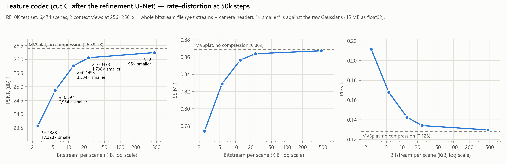

# MVSplat + Feature Codec (Mean-Scale Hyperprior)

MVSplat을 송신측과 수신측으로 나누고, 그 사이에서 오가는 중간 feature를 learned codec(Mean-Scale Hyperprior)으로 압축하는 버전입니다. 송신측은 context 이미지 2장에서 feature를 뽑아 bitstream 파일로 압축하고, 수신측은 그 파일만으로 3D Gaussian을 복원해 렌더링합니다.

[MVSplat](https://github.com/donydchen/mvsplat)을 기반으로 합니다. 데이터셋 준비와 원본 모델 사용법은 아래쪽 [원본 MVSplat README](#원본-mvsplat-readme)를 따르세요.



## 구조

```text
송신측  이미지 2장 → backbone → cost volume → Depth Refinement U-Net ─┐
                                                                    절단 → g_a → 양자화 · entropy coding → bitstream 파일
수신측  bitstream 파일 → entropy decoding → g_s → Gaussian head → Gaussian adapter → rasterizer
```

| 항목 | 내용 |
| --- | --- |
| 절단 위치 | Depth Refinement U-Net 직후 (`model.encoder.codec_cut=post_unet_skip`) |
| 전송 텐서 (view당) | `refine_out(32) ‖ RGB(3) ‖ proj_feat(128) ‖ disp(1)` = 164 ch × 256 × 256 |
| codec | compressai 기반 Mean-Scale Hyperprior (N=192, M=320), GDN/IGDN, wavelet aux transform (WLS/iWLS), IGDN gain 상한 10 |
| Gaussian head | 원본 MVSplat 그대로라서 공개 `re10k.ckpt`의 가중치를 전부 불러오고, codec만 새로 학습합니다 |
| bitstream 파일 | scene당 1개: view 2장의 y·z 스트림과 카메라·shape 헤더 |

`codec_cut`으로 `pre_unet`(U-Net 직전, 133 ch)과 `post_unet`(U-Net 직후 `refine_out ‖ disp`만, 33 ch)도 고를 수 있습니다. 공개 checkpoint는 `post_unet_skip`뿐입니다.

## 결과

RE10K test set 6,474 scenes, context 2장(256×256), 50,000 step checkpoint입니다. scene마다 실제 bitstream 파일을 쓰고 그 파일만 읽어 복원한 뒤 측정했습니다.

| λ | 파일 크기 / scene | raw 대비 | PSNR ↑ | SSIM ↑ | LPIPS ↓ |
| ---: | ---: | ---: | ---: | ---: | ---: |
| 2.388 | 2.54 KiB | 1/17,328 | 23.569 | 0.7739 | 0.2115 |
| 0.597 | 5.55 KiB | 1/7,934 | 24.862 | 0.8289 | 0.1678 |
| 0.1493 | 12.46 KiB | 1/3,534 | 25.758 | 0.8563 | 0.1426 |
| 0.0373 | 24.49 KiB | 1/1,798 | 26.056 | 0.8638 | 0.1340 |
| 0.0 | 461.26 KiB | 1/95 | 26.244 | 0.8672 | 0.1296 |
| 압축 없음 (공개 MVSplat `re10k.ckpt`) | – | – | 26.387 | 0.8690 | 0.1284 |

- raw는 Gaussian을 float32 그대로 보낼 때의 크기입니다: 2 view × 256×256개 × 86 값 × 4 B = 44,032 KiB.
- λ=0은 rate 항이 없어서 entropy model이 학습되지 않습니다. 양자화만 했을 때의 화질 기준점으로 보면 됩니다.
- 처리 시간 (평가 로그의 scene당 평균, 서버 GPU 1장): 송신 74–79 ms, 수신 86–91 ms입니다. 같은 환경에서 압축 없는 MVSplat의 encoder는 73 ms입니다. rasterize는 target view 1장당 2.5–3.1 ms로 따로 측정됩니다.

## Checkpoint

[Releases](https://github.com/pataegonia/OnDevice/releases)에 λ별로 5개가 있습니다.

```text
C50k_lmbda0.0_step50000.ckpt      C50k_lmbda0.0373_step50000.ckpt   C50k_lmbda0.1493_step50000.ckpt
C50k_lmbda0.597_step50000.ckpt    C50k_lmbda2.388_step50000.ckpt    SHA256SUMS
```

optimizer 상태를 뺀 평가용 파일(각 124 MiB)이라 학습을 이어서 돌릴 수는 없습니다. `checkpoints/codec/`에 두면 아래 명령을 그대로 쓸 수 있습니다. 학습 checkpoint에서 이런 파일을 만드는 스크립트는 `scripts/export_ckpts.py`입니다.

## 설치

원본과 같습니다. `requirements.txt`에 `compressai==1.2.8`과 `pywavelets`가 추가되어 있습니다.

```bash
git clone https://github.com/pataegonia/OnDevice.git
cd OnDevice
conda create -n mvsplat python=3.10
conda activate mvsplat
pip install torch==2.1.2 torchvision==0.16.2 torchaudio==2.1.2 --index-url https://download.pytorch.org/whl/cu118
pip install -r requirements.txt
```

RE10K 데이터는 원본 README의 [Acquiring Datasets](#acquiring-datasets)대로 `datasets/re10k`에 둡니다.

## 평가

```bash
python -m src.main +experiment=re10k_codec \
mode=test \
dataset/view_sampler=evaluation \
test.compute_scores=true \
checkpointing.load=checkpoints/codec/C50k_lmbda0.0373_step50000.ckpt \
model.encoder.codec_cut=post_unet_skip \
model.encoder.codec_igdn_max_gain=10.0 \
wandb.name=C50k_lmbda0.0373
```

- `re10k_codec` 설정은 `test.compress=true`라서, scene마다 bitstream을 `outputs/test/<wandb.name>/bitstream/<scene>.bin`에 쓰고 그 파일만 읽어 복원합니다.
- 점수는 `outputs/test/<wandb.name>/scores_all_avg.json`과 stdout 끝(`psnr`, `ssim`, `lpips`, `bitstream_kib` 등)에 나옵니다.
- `codec_cut`은 학습할 때와 같아야 합니다. 다르면 오류 없이 `to_gaussians.0`이 새로 초기화됩니다.
- 렌더 이미지가 필요 없으면 `test.save_image=false`를 붙입니다.
- SLURM에서는 `scripts/eval_codec.slurm`을 씁니다 (GPU 1장 전용):
  `CODEC_CUT=post_unet_skip CKPT=<ckpt> RUN_NAME=<이름> DATA_ROOT=<re10k 경로> sbatch scripts/eval_codec.slurm model.encoder.codec_igdn_max_gain=10.0`
- R-D 그림은 평가 로그로 `python scripts/plot_rd.py --logs <로그 폴더> --baseline-log <압축 없는 평가 로그>`를 실행해 그립니다.

## 학습

공개 MVSplat `re10k.ckpt`에서 시작해 codec을 붙여 fine-tune합니다. 원본 README의 [Training](#training) 절처럼 `checkpoints/`에 `re10k.ckpt`와 unimatch backbone(`gmdepth-scale1-resumeflowthings-scannet-5d9d7964.pth`)이 있어야 합니다.

SLURM (GPU 1장, batch 2 × accumulation 32 = 유효 batch 64, 50,000 step):

```bash
TOTAL_SAMPLES=3200000 CODEC_CUT=post_unet_skip LMBDA=0.0373 RUN_NAME=C50k_lmbda0.0373 \
sbatch scripts/train_codec.slurm \
optimizer.cosine_lr=true optimizer.lr=0.0001 model.encoder.codec_igdn_max_gain=10.0
```

SLURM 없이 같은 설정으로 돌리려면:

```bash
python -m src.main +experiment=re10k_codec \
checkpointing.load=checkpoints/re10k.ckpt \
checkpointing.resume=false \
checkpointing.every_n_train_steps=2000 \
output_dir=outputs/codec/C50k_lmbda0.0373 \
model.encoder.codec_cut=post_unet_skip \
train.lmbda=0.0373 \
optimizer.cosine_lr=true \
optimizer.lr=0.0001 \
model.encoder.codec_igdn_max_gain=10.0 \
data_loader.train.batch_size=2 \
trainer.accumulate_grad_batches=32 \
trainer.max_steps=50000 \
dataset.view_sampler.warm_up_steps=25000
```

- R-D 곡선의 점마다 λ를 바꿔 따로 학습합니다: 0.0 / 0.0373 / 0.1493 / 0.597 / 2.388. rate 항은 추정 bit 수를 (Gaussian 수 × 86)으로 나눈 값이라 이미지 bpp와는 다릅니다.
- `optimizer.cosine_lr=true optimizer.lr=0.0001`을 꼭 넘깁니다. `re10k_codec.yaml` 기본값(최고 lr 2e-4, warm-up 뒤 일정)으로는 6k–15k step 사이에서 학습이 발산했습니다.
- `train.skip_loss_above: 1.0`이 기본으로 켜져 있어 loss가 1을 넘는 batch는 건너뛰고, 64번 연속이면 학습을 멈춥니다.
- float 설정은 소수점을 넣어 씁니다 (`train.lmbda=0.0`, `codec_igdn_max_gain=10.0`). `0`이나 `10`처럼 정수로 쓰면 config 로더가 거부합니다.
- 이어서 학습할 때는 `RESUME=true CKPT=<마지막 학습 checkpoint> RUN_NAME=<새 이름>`을 더하고, `TOTAL_SAMPLES`와 뒤쪽 override를 처음과 똑같이 넘깁니다. 재개하면 저장된 lr 스케줄을 config의 `optimizer.lr`에 맞춰 다시 조정하므로, override를 빠뜨리면 lr이 바뀝니다. 로그에 `resume: lr schedule rescaled by 1`이 찍히면 정상입니다.

### 공개 checkpoint의 학습 경과

- 다섯 개 모두 위 레시피로 0 step부터 학습했고, 중간에 여러 번 재개해 50,000 step을 채웠습니다. GPU는 1–2장을 썼고 유효 batch는 64로 같습니다.
- 마지막 재개 구간(38,000 → 50,000 step, λ2.388은 36,000 → 50,000 step)은 `optimizer.lr` 없이 실행되었습니다. 그래서 로그에 `resume: lr schedule rescaled by 2 to peak 0.0002`가 찍혔고, 이 구간은 재개 시점의 lr이 계획의 2배로 맞춰진 채 학습되었습니다. 이 구간에서 건너뛴 batch는 없습니다.

## 바뀐 파일

| 파일 | 내용 |
| --- | --- |
| `src/model/encoder/compression/` | codec 본체: `compressor.py`(MeanScaleHyperpriorBase), `ops.py`(GDN, 양자화, bitstream 파일 쓰기/읽기), `auxt.py`(WLS/iWLS), `pywave.py`(DWT/IDWT) |
| `src/model/encoder/costvolume/depth_predictor_multiview.py` | depth predictor를 송신 부분(`forward`)과 수신 부분(`generate_raw_gaussians`)으로 나누고, `codec_cut`에 따라 전송 텐서를 정함 |
| `src/model/encoder/encoder_costvolume.py` | 두 부분 사이에 codec을 넣음. 학습용 forward와 실제 압축용 `compress` / `decompress` |
| `src/model/model_wrapper.py` | rate 항(`train.lmbda`), 실제 bitstream 평가(`test.compress`), loss spike guard, 재개 시 lr 스케줄 조정 |
| `src/main.py` | checkpoint를 불러올 때 shape이 다른 key는 버리고 목록을 출력 |
| `config/experiment/re10k_codec.yaml`, `config/main.yaml`, `config/model/encoder/costvolume.yaml` | codec 설정과 기본값 |
| `scripts/` | 학습/평가 SLURM 스크립트, checkpoint별 평가 sweep(`eval_sweep.slurm`, `summarize_sweep.py`), R-D 그림(`plot_rd.py`), 배포용 checkpoint 만들기(`export_ckpts.py`) |

---

## 원본 MVSplat README

<p align="center">
  <h1 align="center">MVSplat: Efficient 3D Gaussian Splatting <br> from Sparse Multi-View Images</h1>
  <p align="center">
    <a href="https://donydchen.github.io/">Yuedong Chen</a>
    &nbsp;·&nbsp;
    <a href="https://haofeixu.github.io/">Haofei Xu</a>
    &nbsp;·&nbsp;
    <a href="https://chuanxiaz.com/">Chuanxia Zheng</a>
    &nbsp;·&nbsp;
    <a href="https://bohanzhuang.github.io/">Bohan Zhuang</a> <br>
    <a href="https://people.inf.ethz.ch/marc.pollefeys/">Marc Pollefeys</a>
    &nbsp;·&nbsp;
    <a href="http://www.cvlibs.net/">Andreas Geiger</a>
    &nbsp;·&nbsp;
    <a href="https://personal.ntu.edu.sg/astjcham/">Tat-Jen Cham</a>
    &nbsp;·&nbsp;
    <a href="https://jianfei-cai.github.io/">Jianfei Cai</a>
  </p>
  <h3 align="center">ECCV 2024 Oral</h3>
  <h3 align="center"><a href="https://arxiv.org/abs/2403.14627">Paper</a> | <a href="https://donydchen.github.io/mvsplat/">Project Page</a> | <a href="https://drive.google.com/drive/folders/14_E_5R6ojOWnLSrSVLVEMHnTiKsfddjU">Pretrained Models</a> </h3>
<!--   <div align="center">
    <a href="https://news.ycombinator.com/item?id=41222655">
      
    </a>
  </div> -->

<ul>
<li><b>20/01/25 Update:</b> Check out Cheng's <a href="https://github.com/chengzhag/PanSplat">PanSplat [CVPR '25]</a>, which extends MVSplat to higher resolutions (up to 4K) and highlights the use of a hierarchical spherical cost volume and two-step deferred backpropagation for memory-efficient training. </li>
<li><b>08/11/24 Update:</b> Explore our <a href="https://github.com/donydchen/mvsplat360">MVSplat360 [NeurIPS '24]</a>, an upgraded MVSplat that combines video diffusion to achieve 360° NVS for large-scale scenes from just 5 input views! </li>  
<li><b>21/10/24 Update:</b> Check out Haofei's <a href="https://github.com/cvg/depthsplat">DepthSplat [CVPR '25]</a> if you are interested in feed-forward 3DGS on more complex scenes (DL3DV-10K) and more input views (up to 12 views)!</li>
</ul>
<br>
</p>

https://github.com/donydchen/mvsplat/assets/5866866/c5dc5de1-819e-462f-85a2-815e239d8ff2

## Installation

To get started, clone this project, create a conda virtual environment using Python 3.10+, and install the requirements:

```bash
git clone https://github.com/donydchen/mvsplat.git
cd mvsplat
conda create -n mvsplat python=3.10
conda activate mvsplat
pip install torch==2.1.2 torchvision==0.16.2 torchaudio==2.1.2 --index-url https://download.pytorch.org/whl/cu118
pip install -r requirements.txt
```

## Acquiring Datasets

### RealEstate10K and ACID

Our MVSplat uses the same training datasets as pixelSplat. Below we quote pixelSplat's [detailed instructions](https://github.com/dcharatan/pixelsplat?tab=readme-ov-file#acquiring-datasets) on getting datasets.

> pixelSplat was trained using versions of the RealEstate10k and ACID datasets that were split into ~100 MB chunks for use on server cluster file systems. Small subsets of the Real Estate 10k and ACID datasets in this format can be found [here](https://drive.google.com/drive/folders/1joiezNCyQK2BvWMnfwHJpm2V77c7iYGe?usp=sharing). To use them, simply unzip them into a newly created `datasets` folder in the project root directory.

> If you would like to convert downloaded versions of the Real Estate 10k and ACID datasets to our format, you can use the [scripts here](https://github.com/dcharatan/real_estate_10k_tools). Our preprocessed versions of the datasets can be found [here](http://schadenfreude.csail.mit.edu:8000/).

### DTU (For Testing Only)

* Download the preprocessed DTU data [dtu_training.rar](https://drive.google.com/file/d/1eDjh-_bxKKnEuz5h-HXS7EDJn59clx6V/view).
* Convert DTU to chunks by running `python src/scripts/convert_dtu.py --input_dir PATH_TO_DTU --output_dir datasets/dtu`
* [Optional] Generate the evaluation index by running `python src/scripts/generate_dtu_evaluation_index.py --n_contexts=N`, where N is the number of context views. (For N=2 and N=3, we have already provided our tested version under `/assets`.)

## Running the Code

### Evaluation

To render novel views and compute evaluation metrics from a pretrained model,

* get the [pretrained models](https://drive.google.com/drive/folders/14_E_5R6ojOWnLSrSVLVEMHnTiKsfddjU), and save them to `/checkpoints`

* run the following:

```bash
# re10k
python -m src.main +experiment=re10k \
checkpointing.load=checkpoints/re10k.ckpt \
mode=test \
dataset/view_sampler=evaluation \
test.compute_scores=true

# acid
python -m src.main +experiment=acid \
checkpointing.load=checkpoints/acid.ckpt \
mode=test \
dataset/view_sampler=evaluation \
dataset.view_sampler.index_path=assets/evaluation_index_acid.json \
test.compute_scores=true
```

* the rendered novel views will be stored under `outputs/test`

To render videos from a pretrained model, run the following

```bash
# re10k
python -m src.main +experiment=re10k \
checkpointing.load=checkpoints/re10k.ckpt \
mode=test \
dataset/view_sampler=evaluation \
dataset.view_sampler.index_path=assets/evaluation_index_re10k_video.json \
test.save_video=true \
test.save_image=false \
test.compute_scores=false
```

### Training

Run the following:

```bash
# download the backbone pretrained weight from unimatch and save to 'checkpoints/'
wget 'https://s3.eu-central-1.amazonaws.com/avg-projects/unimatch/pretrained/gmdepth-scale1-resumeflowthings-scannet-5d9d7964.pth' -P checkpoints
# train mvsplat
python -m src.main +experiment=re10k data_loader.train.batch_size=14
```

Our models are trained with a single A100 (80GB) GPU. They can also be trained on multiple GPUs with smaller RAM by setting a smaller `data_loader.train.batch_size` per GPU.

<details>
  <summary><b>Training on multiple nodes (https://github.com/donydchen/mvsplat/issues/32)</b></summary>
Since this project is built on top of pytorch_lightning, it can be trained on multiple nodes hosted on the SLURM cluster. For example, to train on 2 nodes (with 2 GPUs on each node), add the following lines to the SLURM job script

```bash
#SBATCH --nodes=2           # should match with trainer.num_nodes
#SBATCH --gres=gpu:2        # gpu per node
#SBATCH --ntasks-per-node=2

# optional, for debugging
export NCCL_DEBUG=INFO
export HYDRA_FULL_ERROR=1
# optional, set network interface, obtained from ifconfig
export NCCL_SOCKET_IFNAME=[YOUR NETWORK INTERFACE]
# optional, set IB GID index
export NCCL_IB_GID_INDEX=3

# run the command with 'srun'
srun python -m src.main +experiment=re10k \
data_loader.train.batch_size=4 \
trainer.num_nodes=2
```

References:
* [Pytorch Lightning: RUN ON AN ON-PREM CLUSTER (ADVANCED)](https://lightning.ai/docs/pytorch/stable/clouds/cluster_advanced.html)
* [NCCL: How to set NCCL_SOCKET_IFNAME](https://github.com/NVIDIA/nccl/issues/286)
* [NCCL: NCCL WARN NET/IB](https://github.com/NVIDIA/nccl/issues/426)

</details>

<details>
  <summary><b>Fine-tune from the released weights (https://github.com/donydchen/mvsplat/issues/45)</b></summary>
To fine-tune from the released weights <i>without</i> loading the optimizer states, run the following:

```bash
python -m src.main +experiment=re10k data_loader.train.batch_size=14 \
checkpointing.load=checkpoints/re10k.ckpt \
checkpointing.resume=false
```

</details>

### Ablations

We also provide a collection of our [ablation models](https://drive.google.com/drive/folders/14_E_5R6ojOWnLSrSVLVEMHnTiKsfddjU) (under folder 'ablations'). To evaluate them, *e.g.*, the 'base' model, run the following command

```bash
# Table 3: base
python -m src.main +experiment=re10k \
checkpointing.load=checkpoints/ablations/re10k_worefine.ckpt \
mode=test \
dataset/view_sampler=evaluation \
test.compute_scores=true \
wandb.name=abl/re10k_base \
model.encoder.wo_depth_refine=true 
```

### Cross-Dataset Generalization

We use the default model trained on RealEstate10K to conduct cross-dataset evaluations. To evaluate them, *e.g.*, on DTU, run the following command

```bash
# Table 2: RealEstate10K -> DTU
python -m src.main +experiment=dtu \
checkpointing.load=checkpoints/re10k.ckpt \
mode=test \
dataset/view_sampler=evaluation \
dataset.view_sampler.index_path=assets/evaluation_index_dtu_nctx2.json \
test.compute_scores=true
```

**More running commands can be found at [more_commands.sh](more_commands.sh).**

## BibTeX

```bibtex
@article{chen2024mvsplat,
    title   = {MVSplat: Efficient 3D Gaussian Splatting from Sparse Multi-View Images},
    author  = {Chen, Yuedong and Xu, Haofei and Zheng, Chuanxia and Zhuang, Bohan and Pollefeys, Marc and Geiger, Andreas and Cham, Tat-Jen and Cai, Jianfei},
    journal = {arXiv preprint arXiv:2403.14627},
    year    = {2024},
}
```

## Acknowledgements

The project is largely based on [pixelSplat](https://github.com/dcharatan/pixelsplat) and has incorporated numerous code snippets from [UniMatch](https://github.com/autonomousvision/unimatch). Many thanks to these two projects for their excellent contributions!
